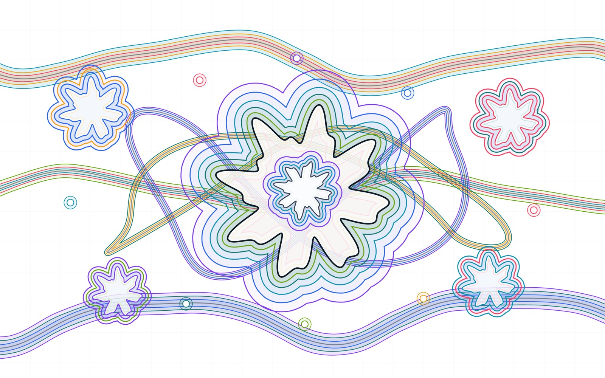

# paperjs-offset

Offset geometry helpers for [Paper.js](https://paperjs.org/).

[](https://glenzli.github.io/paperjs-offset/)

[Open the live demo](https://glenzli.github.io/paperjs-offset/) · [Report an issue](https://github.com/glenzli/paperjs-offset/issues)

This package gives Paper.js projects two operations that are useful in vector editors:

- `offset(path, distance, options)` expands or contracts a closed path.
- `offsetStroke(path, distance, options)` turns a stroked path into a filled outline.

Path offsetting is a geometric approximation problem, especially around Bezier joins, self-intersections, and aggressive negative offsets. The default algorithm tries several strategies and chooses the best-scored result, but difficult shapes can still expose edge cases. Bug reports are most useful when they include `pathData`, distance, options, and the expected shape.

## Install

```sh
npm install paper paperjs-offset
```

`paper` is a peer dependency. The package ships CommonJS, ESM, TypeScript declarations, and browser bundles.

## Quick Start

```ts
import paper from 'paper';
import { offset, offsetStroke } from 'paperjs-offset';

paper.setup(new paper.Size(400, 300));

const path = new paper.Path.Star({
  center: [160, 120],
  points: 8,
  radius1: 70,
  radius2: 36,
  insert: false
});

const expanded = offset(path, 14, {
  join: 'round',
  insert: false
});

const outline = offsetStroke(path, 8, {
  join: 'round',
  cap: 'round',
  insert: false
});
```

For browser pages, include Paper.js first and then the browser build:

```html
<script src="https://cdn.jsdelivr.net/npm/paper@0.12.18/dist/paper-full.min.js"></script>
<script src="https://cdn.jsdelivr.net/npm/paperjs-offset@1/dist/paperjs-offset.min.js"></script>
```

```js
const expanded = paperjsOffset.offset(path, 12, { join: 'round' });
```

## API

```ts
import {
  analyze,
  offset,
  offsetStroke,
  type OffsetOptions,
  type OffsetQuality
} from 'paperjs-offset';
```

```ts
function offset(
  path: paper.Path | paper.CompoundPath,
  distance: number,
  options?: OffsetOptions
): paper.Path | paper.CompoundPath;

function offsetStroke(
  path: paper.Path | paper.CompoundPath,
  distance: number,
  options?: OffsetOptions
): paper.Path | paper.CompoundPath;

function analyze(
  source: paper.Path | paper.CompoundPath,
  result: paper.Path | paper.CompoundPath,
  distance: number,
  options?: { stroke?: boolean }
): OffsetQuality;
```

`OffsetOptions`:

| Option | Values | Default | Notes |
| --- | --- | --- | --- |
| `join` | `'miter'`, `'bevel'`, `'round'` | `'miter'` | Join style for adjacent offset curves. |
| `cap` | `'butt'`, `'round'` | `'butt'` | Terminal style for `offsetStroke`. |
| `limit` | `number` | `10` | Miter limit. |
| `algorithm` | `'auto'`, `'robust'`, `'split'`, `'legacy'` | `'auto'` | Offset strategy. |
| `insert` | `boolean` | `true` | Insert the generated result into the active Paper.js project. |

The static `PaperOffset` export and the default prototype-extension helper still exist for older code, but new code should prefer the named functions above.

## Algorithms

`algorithm: 'auto'` is the default. It runs the available strategies, scores each result with `analyze`, and returns the lowest-scoring result.

| Strategy | Use case |
| --- | --- |
| `auto` | Best default for application code and demos. |
| `robust` | Extra cleanup for concave joins and self-intersecting stroke outlines. |
| `split` | Splits self-intersecting curves with less cleanup than `robust`. |
| `legacy` | Closest behavior to older releases. Useful when preserving historical output matters. |

You can inspect output quality directly:

```ts
const result = offset(path, -12, {
  algorithm: 'auto',
  insert: false
});

const quality = analyze(path, result, -12);

console.log(quality.score, quality.warnings);
```

`quality.warnings` can report problems such as self-intersections, unexpected area changes, containment errors, or distance collapse. The stress tests use the same scorer.

## Demos

The repository is prepared for GitHub Pages at:

https://glenzli.github.io/paperjs-offset/

Enable it in the repository settings with:

- Source: deploy from a branch
- Branch: `master`
- Folder: `/(root)`

The root `index.html` redirects to `demo/index.html`. The demo folder contains:

- `demo/index.html`: curated visual examples.
- `demo/stress.html`: the deterministic stress corpus used by tests.
- `demo/debug.html`: a small page for reproducing individual path cases.

Run the demos locally:

```sh
npm run demo:serve
```

`npm run build` writes browser bundles to `dist/` and then syncs the same generated files into `demo/`, so local demos and published artifacts exercise the same build.

## Development

```sh
npm ci
npm run lint
npm test
npm run test:stress
```

Useful build commands:

```sh
npm run build
npm run build:ts
npm run build:bundles
```

`npm test` rebuilds the package, runs smoke tests, and then runs the generated stress corpus.

## Release

Publishing is intentionally local. There is no GitHub Action that publishes to npm.

```sh
npm version patch
npm run release:check
npm run release:publish
git push origin master --follow-tags
```

`release:check` runs typecheck, tests, `npm audit`, and `npm pack --dry-run`. `release:publish` delegates to `npm publish`; `prepublishOnly` runs the same release check for direct publishes.

## License

MIT. See [LICENSE](LICENSE).
